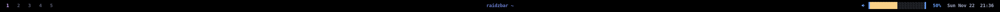

# raidzbar

raidzbar is a **status bar dedicated for niri** written in Rust. It aims to be a minimal yet functional and somewhat good-looking status bar. This bar is a **standalone binary file**.

A reason I created this is because there isn't a good enough option that is both minimal and support enough features of a modern status bar.

For example, why the f*** do I need to install **24 different packages** just to use Waybar? Other minimal bars doesn't support tray modules, which is the sole reason I need a status bar. Ironbar? It sucks when it comes to configuration files, why do I need to rewrite the whole default configuration when I just want to change a single thing? If so then why don't write it for me?

## Some things worth attention

This is solely for niri to preserve its minimalism goal so if you use other WMs or compositor, it doesn't work.

## Documentation

- [Installation](docs/installation.md)
- [Configuration](docs/configuration.md)

## Images

  

<b>daily</b>

  

<b>default</b>

  

<b>minimal</b>

  

<b>balanced</b>

  

<b>fancy</b>

### Configs
Some example configurations that's created by my abominable taste. Though my daily bar is pretty minimal.

- [daily.toml](config/daily.toml)
- [config.toml](config/config.toml)
- [minimal.toml](config/minimal.toml)
- [balanced.toml](config/balanced.toml)
- [fancy.toml](config/fancy.toml)

## License

raidzbar is licensed under the [Apache License 2.0](LICENSE).
